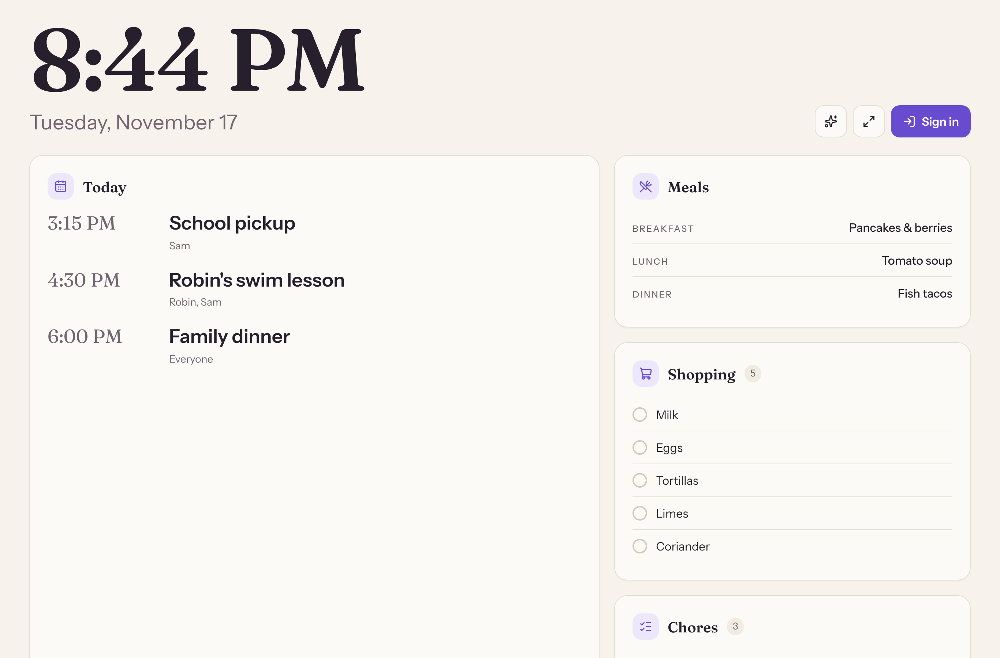
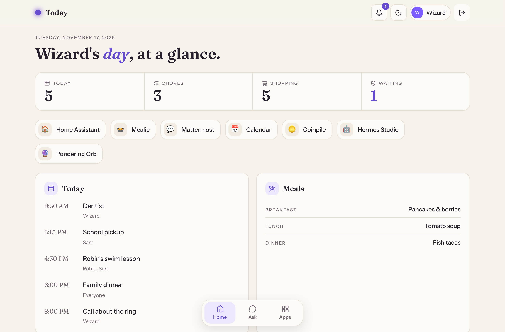
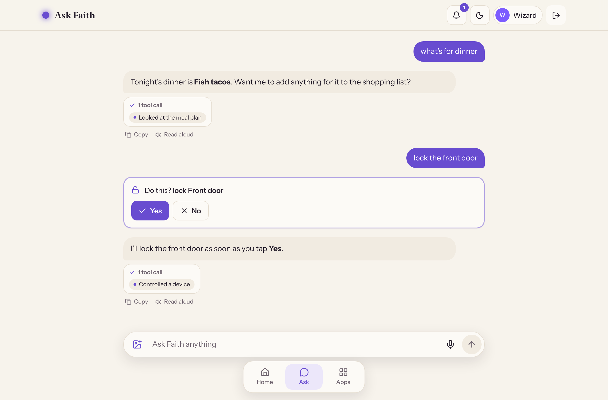
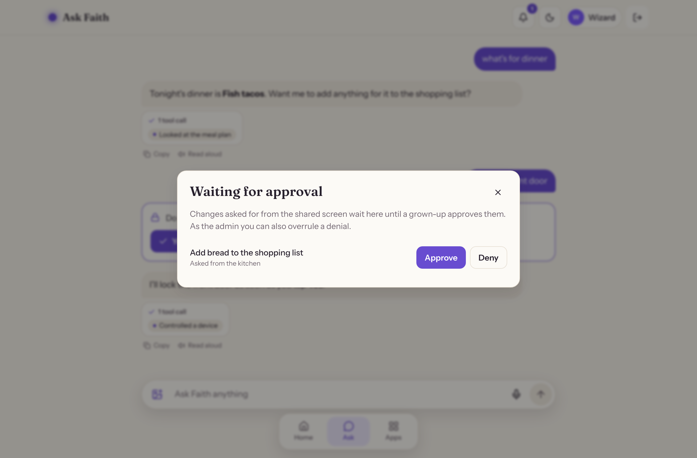

# FAITH: Family Agent for Intelligent Tasks & Help

One assistant the whole family talks to, by text or voice, running entirely on
your own hardware. FAITH is the family's front door: a home screen and
homepage for every app, and an agent that can use all of them. Home Assistant
is its hands, and Argos (local models) is its brain.

```
 wall tablet (HA kiosk) ──┐   phone / laptop ──┐   HA Assist voice ──┐   Mattermost ──┐   other apps (OpenAI API)
                          ▼                    ▼                     ▼                ▼                 ▼
               ┌──────────────────────── FAITH (one container, :8097) ────────────────────────┐
               │ home screen + app launcher · sign-in (PIN, password, Face ID, camera)         │
               │ household view ⇄ person view · approvals · chat · voice in/out · photos      │
               │ the harness: family prompt, tool policy per role, confirm & approve, log     │
               └──┬─────────┬───────────┬──────────────┬──────────┬────────┬────────┬─────────┘
                  │ model   │ MCP       │ MCP          │ REST     │ MCP    │ MCP    │ REST
                  ▼         ▼           ▼              ▼          ▼        ▼        ▼
               Argos     family wiki  ALLGlance     Home         Coinpile  Orb     Hermes /
          (chat, vision, (memory,     (calendar,    Assistant    (money)   (Wiz's  Hermes Studio
           speech in/out) notes)      tasks, chores) (+ Mealie:            own)
                                                     shopping, meals)
```

## How it works

**Two kinds of view, enforced by the backends themselves.**
- Nobody signed in is the *household* view. FAITH uses the blanket family tokens (the wiki's shared-agent token, ALLGlance's household token), so private notes, tasks and money aren't visible to it at all.
- Once someone signs in, FAITH switches to *their* tokens and sees their private things as well.
- Privacy doesn't depend on the prompt: a household token can't read what it isn't allowed to. A source with no token for a view simply isn't offered (money has no household token, for example).

**Like a home hub.**
- A paired wall screen shows the household view to anyone.
- Tap *Sign in*, pick your face tile, and use a PIN, Face ID (a passkey), a password, or let the camera recognise you if you turn that on.
- You're signed out when the camera sees nobody and nobody has touched the screen for a while, after a hard idle limit, or when you tap *Sign out*.
- On your own phone you sign in with a password or Face ID and stay signed in.

**Changes from the household view need approval.**
- Anyone can ask the shared screen to add bread or turn on a light. The change waits until a signed-in adult taps Approve (any adult can), and it then runs with the household's own access.
- The admin can overrule a denial.
- Locks, alarms and the garage always wait for an on-screen Yes, even for adults.
- Children get a short list of what they may change, and only lights, media and fans.

**One agent, all the integrations.** FAITH runs its own tool loop against Argos, so every call goes through its checks:

| Source | What FAITH gets |
|---|---|
| Wiki | memory, notes, each person's context; it loads `context_for` when someone new starts talking |
| ALLGlance | the day, tasks, chores, life events |
| Home Assistant | devices and sensors, plus Mealie's shopping lists and meal plan through HA's Mealie integration |
| Coinpile | money, only for that person |
| Pondering Orb | Wizard's own dashboard, only for Wizard |
| Hermes | big jobs, run in each person's own Hermes profile |
| Hermes Studio | that person's chats, and starting a job there |
| Mattermost | FAITH as a bot: a personal DM each, a family channel, a parents' channel where approvals land ([details](docs/mattermost.md)) |
| Argos | speech-to-text for the mic, text-to-speech for replies, and a vision model for photos |

**Home Assistant is part of it, both ways.**
- FAITH controls the house through HA's API.
- The integration in [`ha/custom_components/faith`](ha/custom_components/faith):
  - makes FAITH the Assist voice agent, and tells FAITH which HA user is speaking;
  - adds FAITH to HA's sidebar, so a tablet running HA is the family kiosk;
  - adds sensors: today, shopping, next meal, chores, who's signed in on each screen, and changes waiting for approval.

| | |
|---|---|
|  |  |
|  |  |

## Where the family meets FAITH

- **Home Assistant:** FAITH's cards on the family dashboard; Assist voice; phone notifications ([docs](docs/home-assistant.md#the-family-dashboard-faiths-cards)).
- **Mattermost:** a personal chat each, a family channel, a parents' channel ([docs](docs/mattermost.md)).
- **FAITH's own page** is the admin console: health, people and voices, skills, routines, points and rewards, approvals, tokens.

## Try it without your homelab

```bash
npm install && npm run build
node --import tsx server/scripts/demo.ts
```

The demo prints a pairing code and PINs. A made-up family, wiki, ALLGlance and Home Assistant stand in for the real ones, and a scripted model stands in for Argos.

## Install on Unraid

1. **Get the files.**
   ```bash
   cd /mnt/user/appdata && git clone https://github.com/Wizard815/F.A.I.T.H faith-src && cd faith-src
   cp docker-compose.example.yml docker-compose.yml && cp .env.example .env && chmod 600 .env
   mkdir -p /mnt/user/appdata/faith/{data,config} && cp config/faith.example.yaml /mnt/user/appdata/faith/config/faith.yaml
   chown -R 1000:1000 /mnt/user/appdata/faith        # the container runs as node (uid 1000)
   ```
2. **Fill in the config.**
   - Put your family, connectors, screens and apps in `faith.yaml`.
   - Put the tokens in `.env`. [docs/setup.md](docs/setup.md) says how to make each one.
3. **Start it.** Run `docker compose up -d --build`, then `docker exec faith faith doctor`. Doctor checks every source with every person's token and the household's.
4. **Set people up.**
   - `docker exec -it faith faith set-pin wizard` and `faith set-password wizard`.
   - Face ID is added from Settings on each device, and needs https: see [docs/hub.md](docs/hub.md).
5. **Pair the wall screen.** Run `docker exec faith faith pair kitchen`, then on the tablet choose *Pair this screen* and type the code.
6. **Connect Home Assistant.**
   - Copy `ha/custom_components/faith` into HA's `config/custom_components/` and restart HA.
   - Make a token with `docker exec faith faith token add ha homeassistant`.
   - Add the *FAITH* integration and pick it as the agent of your Assist pipeline. See [docs/home-assistant.md](docs/home-assistant.md).

## Repository

| Path | What |
|---|---|
| `server/` | Fastify + `node:sqlite` service: auth, harness, connectors, API (`npm test`) |
| `web/` | React + Tailwind app: wall view, home, chat, apps, sign-in, approvals (design: [architecture](docs/architecture.md#the-screens)) |
| `ha/custom_components/faith` | the Home Assistant integration (`cd ha && pytest`) |
| `config/faith.example.yaml` | every setting, commented |
| `docs/` | [architecture](docs/architecture.md) · [setup](docs/setup.md) · [home assistant](docs/home-assistant.md) · [hub & sign-in](docs/hub.md) · [mattermost](docs/mattermost.md) · [decisions](docs/decisions.md) · [roadmap](docs/roadmap.md) |

## API

| Route | Who | What |
|---|---|---|
| `GET /api/session`, `/api/dashboard`, `/api/apps` | screen / person | the home screen |
| `POST /api/chat` | screen / person | a turn, as server-sent events (`text`, `tool`, `confirm`, `approval`, `done`) |
| `POST /api/chat/confirm/:id` | the same person | Yes or No on a held action |
| `GET /api/approvals`, `POST /api/approvals/:id` | adults | approve or deny household changes |
| `POST /api/voice/transcribe`, `/api/voice/speak` | screen / person | speech in and out through Argos |
| `POST /v1/chat/completions`, `GET /v1/models` | `faith token` | FAITH as an OpenAI-compatible model called `faith`, as that token's view |
| `POST /api/ha/conversation`, `GET /api/ha/summary` | `ha` token | for the HA integration |

## License

MIT
