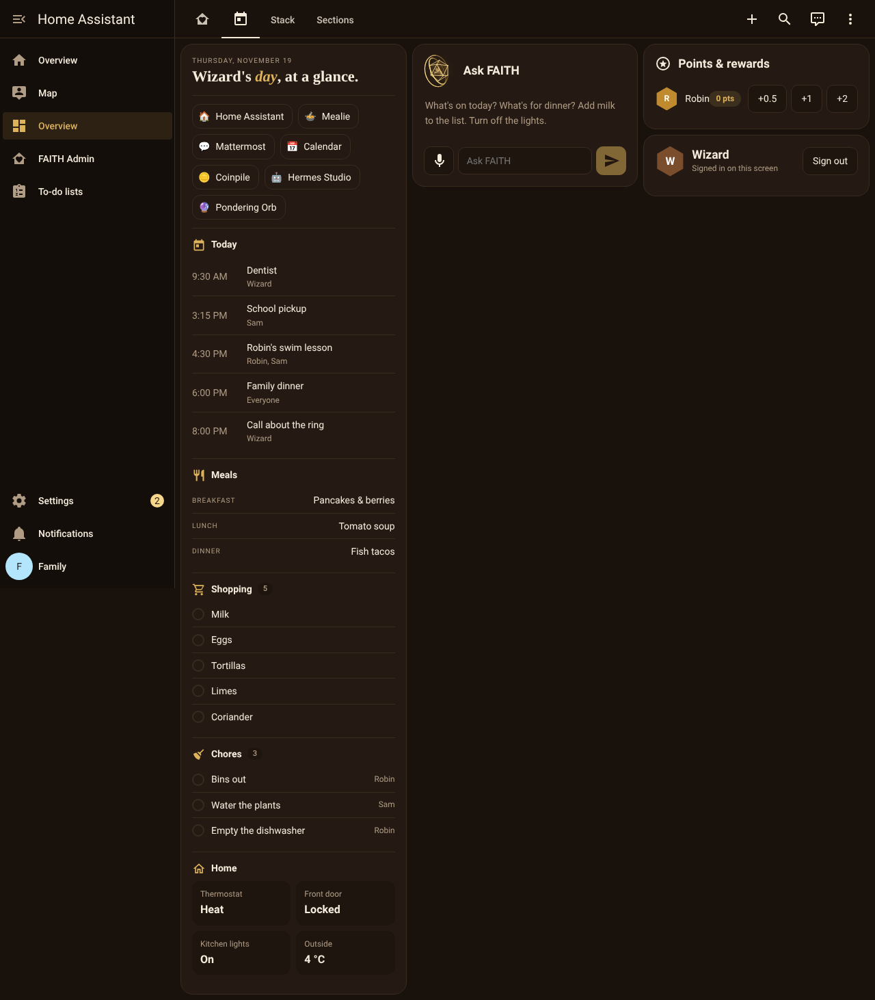

# Architecture

FAITH is one container: a Fastify server (TypeScript, Node 22, built-in `node:sqlite`) that also serves the React app. It keeps only its own state. The family's data stays in the apps that own it.

## A request, start to finish

```
browser / HA / API token
   │  cookie (screen or person session) or bearer token
   ▼
auth/sessions.ts   who is asking?  ->  Caller { scope: household | person, channel, speaker?, audience? }
                   channels: hub, personal, ha (HA cards), voice (Assist), mattermost, api (tokens, /mcp), routine
   ▼
connectors/registry.ts   which tools does this caller get?
   1. the connector allows the caller's role ("household" when nobody's signed in)
   2. the source has a token for the scope: household token, or that person's own token
   3. the role's deny list and write rule: allow | allowlist | deny | approve
   ▼
harness/agent.ts   one turn
   - first, HA's fast path: HA's own sentence matcher, with FAITH's rules on its targets; no model
   - family prompt (harness/prompt.ts): who, where, who's home, rules; the wiki's context_for on a new conversation
   - harness/router.ts: more than tools.max tools? offer the ones that fit the question (embeddings or shared words)
   - the loop (harness/llm.ts) against Argos's /v1/chat/completions, streaming
   - every tool call is wrapped:
       approve  -> stored in approvals.ts, waits for a family member
       confirm  -> stored as pending, waits for this person's Yes (locks, alarm, garage, destructive MCP tools)
       else     -> runs with the caller's token; changes go to the action log
   ▼
the source (wiki, ALLGlance, HA, Coinpile, Orb, Hermes, Studio) decides what that token may see
```

## Quick, small and big requests

A request takes one of three ways.

- **Instant (no model).** "Turn off the kitchen lights", "what time is it". HA's own sentence matcher does it, after FAITH checks what it would touch. Under a second. Anything that needs a Yes or an approval goes the model's way. See [home-assistant.md](home-assistant.md).
- **Small.** One model turn with a few tool calls. It answers within `model.answer_within_s` (30 s by default; spoken requests use `voice.answer_within_s`, 10 s).
- **Big.** "Plan this week's dinners" takes many rounds. When it passes that time, the person hears "This one's a bigger job. I'll send you the answer when it's done." It carries on.
  - Its answer goes where they asked: the same Mattermost chat, or their chat and phone when they asked in HA.
  - It's also in the conversation, so the HA card shows it later.
  - On the household screen nobody can be sent the answer, so it waits as before.

**Several at once.** A local model answers one request at a time (`model.parallel`, default 1), so FAITH queues its model calls itself (`harness/gate.ts`).
- A big job holds its place only while the model is answering, not while its tools run.
- Once a job is "big", its next calls wait behind quick questions. Someone asking the time while a dinner plan is being made waits for one round at most.
- Instant requests don't queue at all.

## Three layers of protection

1. **Tokens: what each view can see.**
   - The household view only ever holds blanket tokens. The wiki's shared-agent token and ALLGlance's household token can't read private items, whatever the model asks for.
   - A source with no household token (Coinpile, Orb) doesn't exist in that view.
2. **Policy: what each role may do.** This is FAITH's own decision, in `roles:`.
   - Children get a short allowlist and only some kinds of device.
   - The household view's changes need an adult's approval.
   - Hermes is off for children and the household.
3. **Confirmation: the riskiest actions.** Locks, alarm, garage and anything an MCP server marks destructive wait for a Yes from the same person, on the same screen or in the same chat. Voice and API callers (including `/mcp`) can't give one, so those actions are refused there (unless `voice.confirm_on_voice`).

**A photo or video can't make changes by itself.** In a turn that carries one, every change waits for the person's own Yes (`Agent.wrap`). Text in a picture or words in a video's sound can read like a request; the model may follow them, the code doesn't let it act alone.

**Approvals never stand in for a Yes on the risky ones.** Unlocking, disarming, opening, and anything an MCP server marks destructive can't be asked for from a view that needs approval: no request is made, so nobody can approve one by mistake. Every approved request is claimed once, so two parents tapping Approve don't run it twice, and it goes into the action log.

**Where people are stays in Home Assistant.** FAITH sees `person.*` and trackers only as home or away, and never address, GPS or zone sensors, whatever the config exposes.

**Speakers, not sign-ins.** In a group chat, or from a recognised voice on a shared screen or satellite, FAITH knows *who is speaking* but still answers from the household view, because everyone there hears the answer. The speaker only decides whose changes need approval.

An approved household request runs with the household's tokens, not the approver's. Approving never lends someone's private access to the shared screen.

## What FAITH stores (`/data/faith.db`)

| Table | What |
|---|---|
| `person_auth`, `passkeys` | PIN and password hashes (scrypt), lockout counters, passkey public keys |
| `devices`, `pair_codes` | paired screens (token hash), one-time pairing codes |
| `sessions` | signed-in people: on which screen, last activity |
| `api_tokens` | `faith token` tokens (sha-256 only) |
| `conversations`, `messages` | chat history per view and channel; a person's chats are only theirs |
| `pending`, `requests` | held confirmations; household changes waiting for approval |
| `audit` | every change FAITH made: who, where, what, whether it worked |
| `routines` | scheduled skills: when, as whom, to where, how the last run went |
| `reward_*`, `points_ledger`, `payouts` | jobs, rewards, points, and money rewards (owed, paid, or recorded in Firefly) |
| `voiceprints` | one averaged voiceprint per person (never audio) |
| `person_prefs` | each person's arrangement of their day card |
| `mm_state` | the Mattermost bot's channels and welcome messages |

Secrets never go in `faith.yaml`. It names environment variables, the same convention as Orb, Coinpile and ALLGlance.

## Why one agent loop in FAITH

FAITH could hand every turn to Hermes. It runs its own small loop instead (adapted from Pondering Orb's Golem) so that one place decides, per person and per role, which tools exist and what needs a Yes. Hermes is still there for the big jobs: `hermes_ask` runs in that person's own Hermes profile, and `studio_start` starts a job in Hermes Studio.

The loop is OpenAI-compatible, so the model is whatever Argos serves, and FAITH also *is* a model to other apps: `/v1/chat/completions` with a `faith token` answers with that token's view and rules.

## Where the family meets FAITH

| Where | How | Who it acts as |
|---|---|---|
| Home Assistant dashboard | FAITH's cards over HA's websocket (`faith/call`, a fixed list of paths) | the HA user who's looking, or whoever signed in on that tablet |
| HA Assist and voice satellites | FAITH as conversation agent; FAITH's own Wyoming speech-to-text and voice (`wyoming.ts`) | the mapped HA user, or the household with a recognised speaker |
| Mattermost | the bot: a DM each, a family channel, a parents' channel | the person (DM), or the household with a speaker (channels) |
| Phones | HA notifications; Approve / Deny buttons | the person who tapped |
| Other agents | `/v1/chat/completions` and `/mcp` with a `faith token` | that token's view |
| FAITH's own page | the admin console | admins only |

## What runs in the background

- **Routines** (`routines.ts`): scheduled skills, checked every 30 seconds, caught up within the hour.
- **The integrations watch** (`health.ts`): every source checked every two minutes; the parents hear when one goes down and when it's back.
- **Presence** (`auth/presence.ts`): each screen's camera sensors for sign-out, and HA's `person.*` entities for who's home.
- **The Mattermost bot** keeps its channels' members right.

## The screens

The family's screens are Home Assistant dashboards with FAITH's cards. FAITH's own page is the admin console. Both use the brass-and-honey theme ([brand.md](brand.md)):
- espresso and parchment, with gold as the accent;
- serif headings (Fraunces) over Instrument Sans;
- hexagon faces and FAITH's emblem.

The fonts ship with the app, so nothing is fetched from the internet. A clickable preview of the whole family UI is in [`brand/faith-hub.html`](brand/faith-hub.html).

| Card | What |
|---|---|
| `faith-hub-card` | the wall tablet's home: the clock, the emblem (tap to talk, answers out loud), who's home, faces to sign in |
| `faith-card` | the day: today, meals, shopping, chores, the house, approvals; each person can arrange theirs |
| `faith-chat-card` | chat with FAITH, with Yes and approval cards |
| `faith-rewards-card` | points, jobs, rewards, the kid's card |
| `faith-who-card` | who's signed in on this tablet; the PIN pad |

| | |
|---|---|
|  |  |
|  |  |
