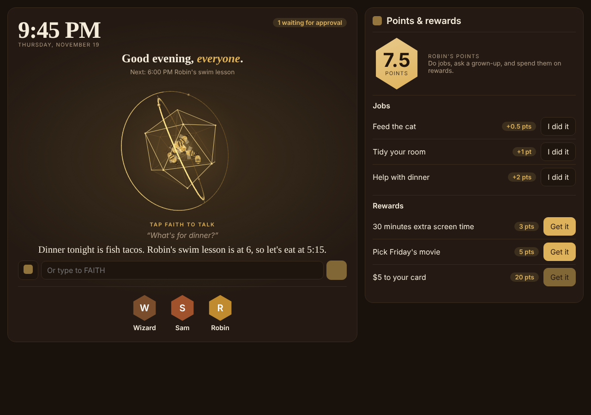
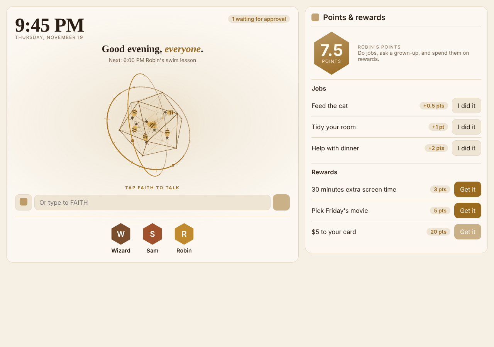
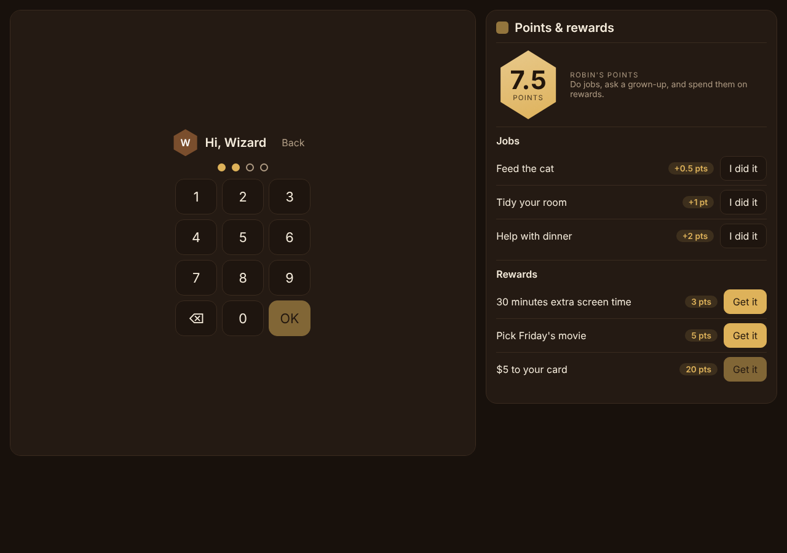
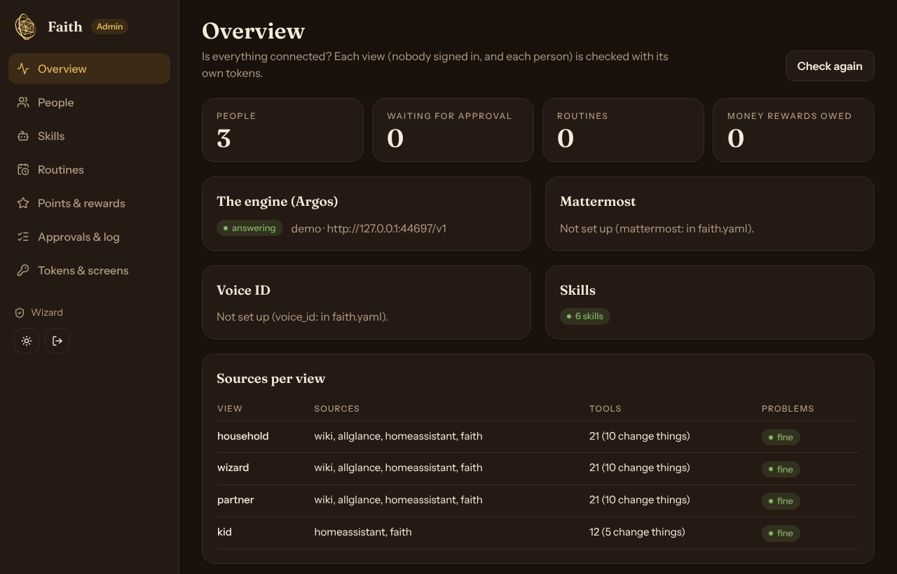

# Architecture

FAITH is one container: a Fastify server (TypeScript, Node 22, built-in `node:sqlite`) that also serves the React app. It keeps only its own state. The family's data stays in the apps that own it.

## A request, start to finish

```
browser / HA / API token
   │  cookie (screen or person session) or bearer token
   ▼
auth/sessions.ts   who is asking?  ->  Caller { scope: household | person, channel: hub | personal | voice | api }
   ▼
connectors/registry.ts   which tools does this caller get?
   1. the connector allows the caller's role ("household" when nobody's signed in)
   2. the source has a token for the scope: household token, or that person's own token
   3. the role's deny list and write rule: allow | allowlist | deny | approve
   ▼
harness/agent.ts   one turn
   - family prompt (harness/prompt.ts): who, where, rules; the wiki's context_for on a new conversation
   - the loop (harness/llm.ts) against Argos's /v1/chat/completions, streaming
   - every tool call is wrapped:
       approve  -> stored in approvals.ts, waits for a family member
       confirm  -> stored as pending, waits for this person's Yes on screen (locks, alarm, garage)
       else     -> runs with the caller's token; changes go to the action log
   ▼
the source (wiki, ALLGlance, HA, Coinpile, Orb, Hermes, Studio) decides what that token may see
```

## Three layers of protection

1. **Tokens: what each view can see.**
   - The household view only ever holds blanket tokens. The wiki's shared-agent token and ALLGlance's household token can't read private items, whatever the model asks for.
   - A source with no household token (Coinpile, Orb) doesn't exist in that view.
2. **Policy: what each role may do.** This is FAITH's own decision, in `roles:`.
   - Children get a short allowlist and only some kinds of device.
   - The household view's changes need an adult's approval.
   - Hermes is off for children and the household.
3. **Confirmation: the riskiest actions.** Locks, alarm and garage wait for a Yes from the same person on the same screen. Voice and API callers can't give one, so those actions are refused there (unless `voice.confirm_on_voice`).

An approved household request runs with the household's tokens, not the approver's. Approving never lends someone's private access to the shared screen.

## What FAITH stores (`/data/faith.db`)

| Table | What |
|---|---|
| `person_auth`, `passkeys` | PIN and password hashes (scrypt), lockout counters, passkey public keys |
| `devices`, `pair_codes` | paired screens (token hash), one-time pairing codes |
| `sessions` | signed-in people: on which screen, last activity |
| `api_tokens` | `faith token` tokens (sha-256 only) |
| `conversations`, `messages` | chat history per view and channel; a person's chats are only theirs |
| `pending`, `requests` | held confirmations; household changes waiting for approval |
| `audit` | every change FAITH made: who, where, what, whether it worked |

Secrets never go in `faith.yaml`. It names environment variables, the same convention as Orb, Coinpile and ALLGlance.

## Why one agent loop in FAITH

FAITH could hand every turn to Hermes. It runs its own small loop instead (adapted from Pondering Orb's Golem) so that one place decides, per person and per role, which tools exist and what needs a Yes. Hermes is still there for the big jobs: `hermes_ask` runs in that person's own Hermes profile, and `studio_start` starts a job in Hermes Studio.

The loop is OpenAI-compatible, so the model is whatever Argos serves, and FAITH also *is* a model to other apps: `/v1/chat/completions` with a `faith token` answers with that token's view and rules.

## The screens

The web app follows the design language of the family organizers that inspired it ([decisions.md](decisions.md)):
- warm paper and a neutral dark theme;
- serif headings (Fraunces) over Instrument Sans;
- hairline cards, a stats strip and a floating pill tab bar.

The fonts ship with the app, so nothing is fetched from the internet.

| Screen | What |
|---|---|
| Wall view | a paired screen with nobody signed in: a big clock, today, meals, shopping, chores, and *Talk* / *Ask* |
| Home | "*name*'s day, at a glance": stats, the apps launcher, cards |
| Ask | the chat, with tool calls shown as chips, Copy and Read aloud, a photo button, the mic, and Yes / approval cards |
| Apps | every app that viewer may open |
| Sheets | who's here (face tiles, PIN pad, Face ID, password), settings, waiting for approval |

| | |
|---|---|
|  |  |
|  |  |
