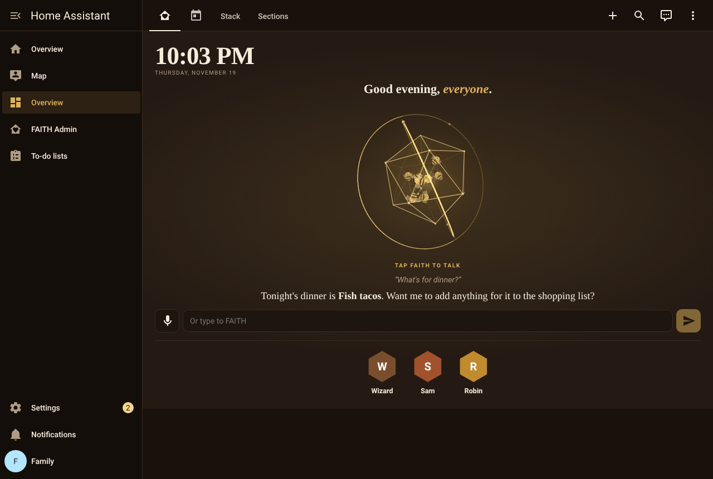
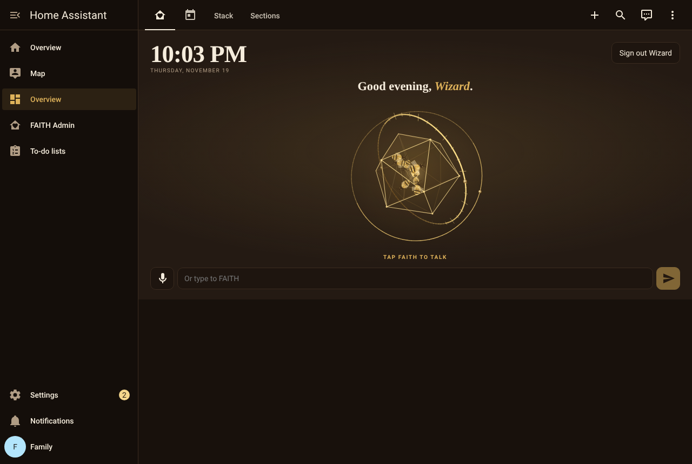
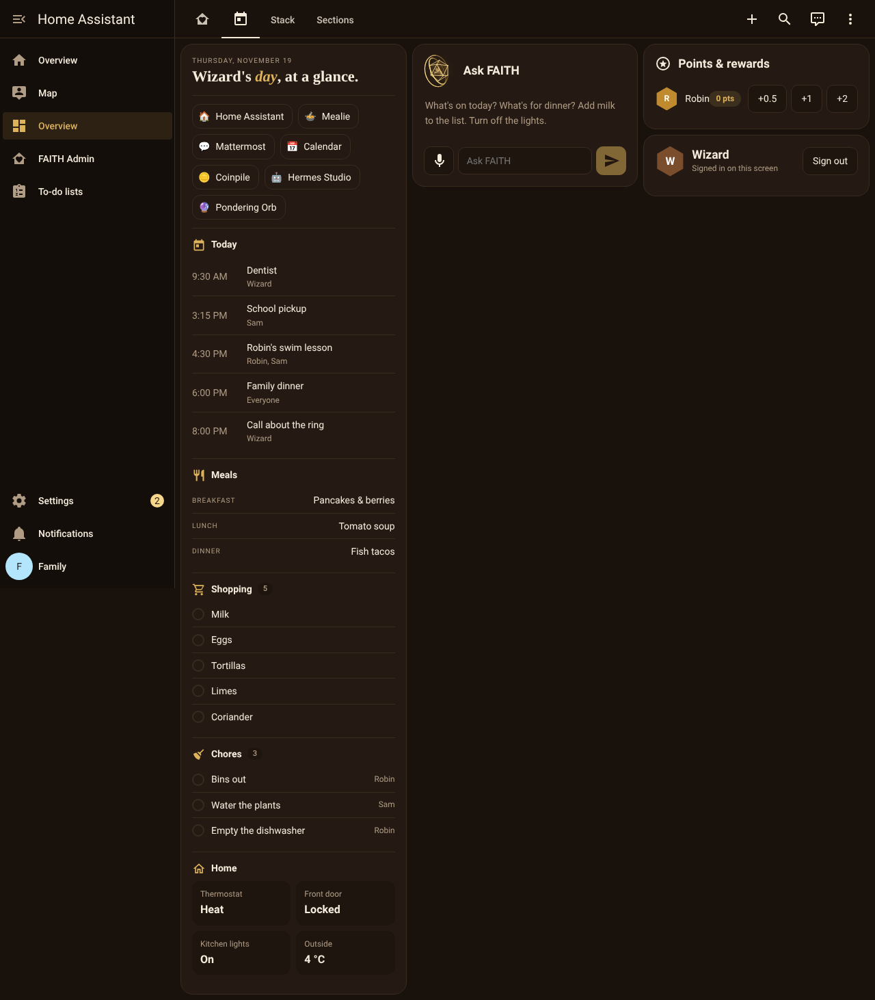
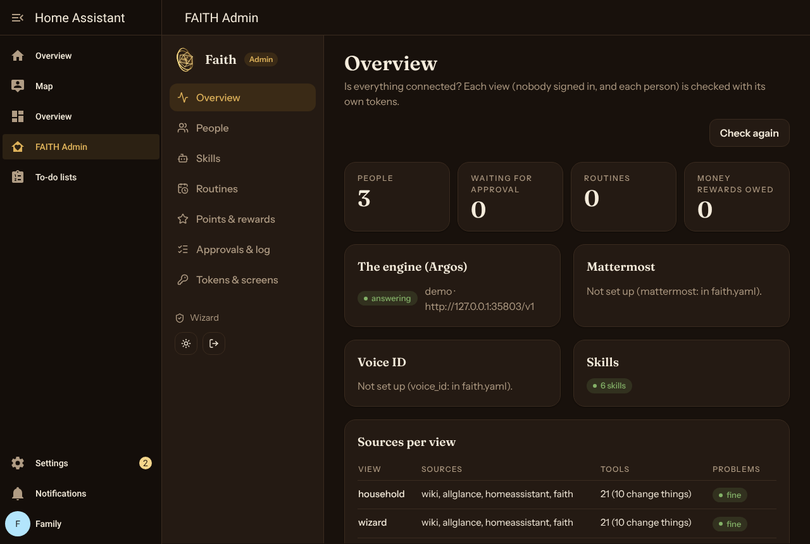

# FAITH and Home Assistant

## Container, not an add-on

FAITH runs as its own container on Unraid, next to Argos and the other apps on `ai_net`. A small integration inside HA connects the two.

Why not install it inside the HA VM:
- **Restarts.** HA restarts often (updates, YAML reloads). The family's assistant, its sign-in sessions and its chats shouldn't go down with it.
- **Reach.** FAITH needs the apps on `ai_net` (wiki, ALLGlance, Coinpile, Orb, Hermes, Argos). From the HA VM that's an extra network hop and more firewall rules.
- **Separation.** FAITH holds the family's sign-in secrets and is the one place that decides who sees what. HA's admin users shouldn't be able to read its database.

HA is still where the family meets FAITH: the kiosk, the voice and the automations. If you'd rather run it as an HA add-on later, the same image works; OpenFamily ships one this way.

## What the integration does (`ha/custom_components/faith`)

- **Sidebar page.** FAITH appears in HA's sidebar ("FAITH", a heart-house icon) for everyone. A wall tablet running the HA app or Fully Kiosk with that page is the family's command point, with the HA dashboards one tap away.
- **Assist agent.** Pick FAITH as the conversation agent of an Assist pipeline (Settings → Voice assistants).
  - Voice satellites, the HA app's Assist button and automations then talk to FAITH.
  - Each request carries the HA user. When it matches a person's `ha_user_id` (and `trust_ha_users` is on), FAITH answers in that person's view. Satellites and unknown users get the household view, where changes need approval.
- **Sensors:**

  | Sensor | Value | Attributes |
  |---|---|---|
  | `sensor.faith_today` | count | the items |
  | `sensor.faith_shopping_list` | count | the items |
  | `sensor.faith_next_meal` | the next meal | |
  | `sensor.faith_chores` | count | |
  | `sensor.faith_<screen>_screen` | who's signed in there, or "Household" | |

  The summary also counts changes waiting for approval (`pending_approvals`).

## Install

1. Copy `ha/custom_components/faith` to `/config/custom_components/faith` on the HA VM (Samba or SSH add-on), then restart HA.
2. On Unraid, make a token: `docker exec faith faith token add ha homeassistant`.
3. HA → Settings → Devices & services → Add → **FAITH**:
   - **FAITH URL:** how HA reaches it, e.g. `http://192.168.1.5:8097`.
   - **Token:** the one from step 2.
   - **Address for the sidebar page:** how the family's browsers reach it, e.g. `https://faith.home.lan`. Leave it empty to use the same URL.
4. Voice: Settings → Voice assistants → your pipeline → Conversation agent → **FAITH**.
5. People: Settings → People → each person → their HA user's id goes in `ha_user_id` in `faith.yaml`.

## The sidebar page and sign-in

The sidebar page is FAITH inside a frame. Browsers only send FAITH's sign-in cookie inside the frame when FAITH and HA count as the *same site*. Two setups work:

- **One domain behind your reverse proxy (recommended):** `ha.home.lan` and `faith.home.lan` are the same site, so keep `embed.cookie_samesite: strict`.
  - Add HA's address to `embed.allow_from` (FAITH refuses to be framed by anything else).
  - Face ID needs this setup anyway, because passkeys need https.
- **Different hosts or IPs:** set `embed.cookie_samesite: none`. This requires https (`public_url` starting with `https://`); without https, signing in inside the frame won't stick.

## Presence and faces (for auto sign-out)

Point each screen's `presence_entity` at a sensor that says someone is in front of it: Frigate's person occupancy for that camera zone, an mmWave sensor, and so on.
- FAITH signs a person out once nobody's been there, and nobody has touched the screen, for `away_seconds`.
- A hard limit (`max_idle_seconds`) applies even if someone stays in the room.

`face_entity` is optional: a sensor whose state is the recognised person's name (Frigate face recognition, Double Take).
- It highlights that person's tile.
- With `face_unlock: true` it signs them in on its own. Leave that off for screens children use: a face match is a weaker check than a PIN.

## Voice: a JARVIS for the house

The fully local path, through HA:

```
satellite (wake word) -> HA Assist pipeline -> speech-to-text -> FAITH (conversation agent) -> text-to-speech -> satellite
```

- **Speech-to-text:** FAITH itself (`wyoming:` in `faith.yaml`). It passes the audio to Argos's `/v1/audio/transcriptions` and also recognises the voice (below). HA's Wyoming faster-whisper container works too, without voice ID.
- **Text-to-speech:** FAITH too. The same Wyoming entry also offers text-to-speech "faith" (Argos's `/v1/audio/speech`), so the satellites sound like FAITH's screens. Argos's speech model must be able to return `wav`. HA's Piper container works as well.
- **Which room:** assign each satellite to an area in HA. FAITH looks the area up for every request, so "turn the lights off" or "it's cold in here" means that room.
  - omi-local's `omi-audio` already runs faster-whisper and Piper.
  - hermes-agent's plugin catalog has a `wyoming-voice-bridge`.
- **Wake word:** openWakeWord in HA, with a custom "Hey Faith" model.
- **On FAITH's own screen:** 🎤 records in the browser and Argos transcribes it; the reply is spoken back through Argos.

**Knowing who's speaking.** HA hands conversation agents the *text*, never the audio. So FAITH can also be the pipeline's speech-to-text, which does hear the voice:

```
satellite -> HA Assist pipeline -> FAITH speech-to-text (Wyoming) -> FAITH conversation agent -> text-to-speech -> satellite
                                     |  Argos: the words             ^ "Wizard said this a moment ago"
                                     |  voice ID: who said them  ----+
```

1. In `faith.yaml`, add `wyoming: { port: 10300 }`, and `voice_id:` pointing at the [voiceid](../voiceid/README.md) service.
2. Publish port 10300 in docker compose.
3. Enrol each person's voice in FAITH's admin page (*People*, three short clips each).
4. In HA, add the **Wyoming Protocol** integration with FAITH's address and port 10300. It shows up as speech-to-text "faith".
5. In *Settings → Voice assistants*, make a pipeline with **speech-to-text: faith**, **conversation agent: FAITH** and **text-to-speech: faith**, then give it to your satellites.

What a recognised voice does:
- **It counts as that person speaking in the family's shared view.** A parent's change goes straight through; a child's or an unknown voice's waits for approval.
- **It never unlocks private things.** The answer is still the household view, because everyone in the room hears it.
- **Locks, alarm and garage** still need a Yes on a screen. Unlocking, disarming or opening can't be asked for by voice from the shared view at all. Locking can, and waits for a parent's approval.
- Set `voice_id.trust_for_changes: false` to log who spoke without letting it skip approvals.

How FAITH ties the two together:
- It remembers who said what for one minute and matches it to HA's conversation by the exact words.
- Each match is used once.

Other ways FAITH knows who's talking:
- **The HA app:** the request carries the signed-in HA user.
- **FAITH's cards on a shared screen:** the person signed in, or the voice from the card's microphone.

**Checked in a real Home Assistant (2026.2.3)** with its own Wyoming integration and a pipeline:
- Wizard's voice saying "We need bread" added bread straight away.
- The same words in an unknown voice went to the parents for approval.
- Recognition scores were 0.94 (Wizard) and 0.95 (Sam) on new sentences, with the real voiceid service and synthetic voices.
- Port 10300 has no password in the Wyoming protocol. Set `wyoming.allow_from: [<HA's IP>]` so only Home Assistant can use it (`faith init` does this when it finds HA).
- A voice only counts for requests that come from a satellite. Typed Assist never borrows a voice heard a moment ago.

## Knowing the house: HA's Assist API

Set `assist_api: true` on the `homeassistant` connector (FAITH's HA integration 0.4 or newer). FAITH then controls the house the way HA's own AI agents do. It uses the same Assist API that HA's OpenAI and Ollama integrations use, through the FAITH integration.

```yaml
connectors:
  - id: homeassistant
    type: homeassistant
    url: http://192.168.1.10:8123
    token_env: HA_TOKEN
    assist_api: true
```

What FAITH gets from Home Assistant:
- **The house, described.** HA's overview of your areas, devices and their aliases goes into FAITH's instructions, so "the lights in the kitchen" or a device's nickname just works.
- **HA's own intents** in place of FAITH's generic device tools: `HassTurnOn`, `HassLightSet`, `HassClimateSetTemperature`, `HassSetPosition`, media, fans, vacuums, list items, your exposed scripts, and `GetLiveContext` for "is anything on?".
- **The satellite's room.** A request from a voice satellite carries its device, so Assist prefers that room, and timers work on satellites that support them.
- **Your exposure settings.** Only what you've exposed under *Settings → Voice assistants → Expose* is there. HA leaves locks unexposed by default.

FAITH's rules still apply on top:
- Before any change, FAITH asks HA which entities the call would touch, then checks them.
  - Locks, alarms and covers wait for a Yes.
  - Unlocking, disarming or opening can't be asked for from the shared view at all.
  - A child stays within their kinds of device.
  - `expose.exclude` still applies.
- `GetLiveContext` shows people and trackers only as home or away.
- Mealie's shopping list and meal plan stay FAITH's own tools.

**Checked in a real Home Assistant 2026.2.3** (its demo house) with a real model:
- lights on and off;
- "what's the Ecobee set to?" (live context);
- the heat pump (it read °F from the live state and set 72);
- the shared screen couldn't open the garage;
- closing it waited for a Yes;
- a child could switch lights but not move a window.

## Simple commands without the model (the fast path)

With `assist_api: true`, FAITH first asks HA's own sentence matcher (the built-in "Home Assistant" agent) what a request means. "Turn off the kitchen lights" or "what time is it" is then done in well under a second, with no model. Needs the FAITH integration 0.5 or newer.

- HA says what it would do and which devices it would touch. Nothing is done yet.
- FAITH checks that against its own rules, the same ones the model's tools follow:
  - only switching, setting, media and plain questions;
  - only devices this person may control;
  - nothing that needs a Yes (locks, alarms, covers);
  - nothing that needs approval (the household view);
  - never where someone is, and never scripts.
- Then HA does it and says what it did. HA only does it if the sentence still means exactly what FAITH checked.
- It's in FAITH's action log like any other change.
- Anything else goes to the model as before: a request HA doesn't understand, two requests in one sentence, a lock.
- Turn it off with `fast_path: false` on the `homeassistant` connector.
- Don't turn on HA's own "Prefer handling commands locally" in the voice assistant's settings. It runs commands before FAITH sees them, so it skips FAITH's voice ID and rules. FAITH's fast path is the same speed and keeps them.

## Cameras

FAITH can look through a camera: "who's at the door?", "is the car in the driveway?". Only the cameras you list, only for the people listed:

```yaml
connectors:
  - id: homeassistant
    # ...
    cameras:
      - entity: camera.front_door
        name: Front door
        who: [admin, adult, parents]     # parents: automations may use it too
      - entity: camera.nursery
        who: [admin]
```

- The picture goes to the local vision model (`model.vision_model`, else `model.model`) and nowhere else. Only its words come back.
- `who` defaults to `[admin, adult]`. Add `household` for the kitchen screen, `parents` for automations.
- Text in the picture is reported, never followed. A change FAITH wants to make after looking through a camera waits for the person's own Yes, as with a photo.
- Frigate cameras work the same way through HA's Frigate integration.

**A doorbell that says who's there.** In an automation, use the `faith.look` action:

```yaml
triggers:
  - trigger: state
    entity_id: binary_sensor.doorbell
    to: "on"
actions:
  - action: faith.look
    data:
      camera: camera.front_door
      question: Who is at the door?
      to: parents            # or family, or a person's id: their chat and phone
```

The message reads "Front door: a person in a brown uniform holding a parcel…". An automation acts as the parents' view, so the camera needs `parents` in `who`.

**What goes wrong:**
- "No camera is shared with automations": add `parents` to that camera's `who`.
- "didn't send a picture": the camera is off, asleep, or HA can't reach it.
- "The vision model answered 4xx": Argos has no vision model loaded. Set `model.vision_model`.

## Who's home

FAITH reads each person's HA `person.<id>` entity (phones, the router, whatever HA uses), or `ha_person:` in `faith.yaml` if the name differs. Set `ha_person: ""` to leave someone out.
- **What it uses:** only *home* or *away*. Zones ("Work", "School") are never passed on.
- **FAITH knows it** in every answer ("is anyone home?").
- **The hub card** shows *Home now: …*.
- **Messages to `home`** go to each person who's home right now, for example "dinner's ready" from a routine or `faith.send_message`.
- **A parents' routine** can't be sent to `home` or the family chat, because the children would read it.

## Full control for the parents: ha-mcp

FAITH's own Home Assistant connector does everyday things for everyone: lights, the shopping list, the meal plan.
[ha-mcp](https://github.com/homeassistant-ai/ha-mcp) adds 86 tools that run Home Assistant itself: automations, scripts, scenes, dashboards, helpers, history, logs, backups. Give them to the admin (and, if you like, the parents' chat), so you can ask "make an automation that turns the porch light off at 11".

1. Install the **HA-MCP** integration in HA. Make a separate admin account for it, as its README says.
2. Copy its local connect URL (`http://<ha-ip>:9584/private_…`) into `.env` as `HA_MCP_URL`. The URL is the password, so it lives in `.env`, not in `faith.yaml`.
3. Add it to `faith.yaml`:

```yaml
connectors:
  - id: hamcp
    type: mcp
    url_env: HA_MCP_URL
    auth: none                  # the secret URL is the credential; no token
    roles: [admin]              # required with auth: none; add parents for the parents' chat
    prefix: ""                  # its tools are already called ha_*
    description: "ha-mcp: Home Assistant's configuration (automations, scripts, dashboards, history)"

skills:
  packs:
    - { dir: /config/skill-packs/ha-skills, who: [admin] }   # git clone https://github.com/homeassistant-ai/skills
```

- **Destructive tools wait for a Yes.** Restart, delete, remove: anything ha-mcp marks as destructive waits for an on-screen (or chat) Yes from the person asking.
- **Only the relevant tools.** Above `tools.max` (32) tools, FAITH offers the model the ones that fit the question. It ranks them with Argos embeddings when `model.embed_model` is set, else by shared words. FAITH's own tools are always offered, as is anything in `tools.always`.
- **The best-practices skill.** homeassistant-ai's pack teaches the model how to write good automations: native triggers before templates, entity ids not device ids, the right mode. FAITH loads it, and its reference files, only when an HA job needs it.

## Mealie

FAITH reads and changes Mealie through HA's Mealie integration (shopping lists as to-do entities, the meal plan as calendars, plus Mealie's actions). That's two-way, unlike Mealie's own CalDAV. Setup is in [setup.md](setup.md#home-assistant-and-mealie-through-it).

## The family dashboard (FAITH's cards)

The family uses Home Assistant; FAITH's own page is the admin console. The integration serves five cards, loaded automatically:

```yaml
- type: custom:faith-hub-card      # the wall tablet's home: FAITH to talk to, the time, who's here
  screen: kitchen                  # optional: size: 300, speak: false, show_input: false, cards: [today]
- type: custom:faith-who-card      # shared tablet: who's signed in, "Who's here?" PIN pad, sign out
  screen: kitchen
- type: custom:faith-card          # the day, meals, shopping, chores, the house, approvals
  screen: kitchen                  # optional: cards: [today, meals, shopping]
- type: custom:faith-chat-card     # talk or type to FAITH, or show it a photo or video
  screen: kitchen
- type: custom:faith-rewards-card  # points, jobs to claim, rewards; parents give points
  screen: kitchen
```

- **The hub card is the wall screen.**
  - FAITH's emblem sits in the middle. Tap it to talk, and tap again to send.
  - The answer is shown and read aloud by Argos's text-to-speech. Turn that off with `speak: false`.
  - The emblem listens, thinks and speaks with the voice level.
  - Underneath are the family's faces as hexagons. Tap one for the PIN pad.
  - For a kiosk, put it alone on a panel view and pick the *FAITH* theme (`ha/themes/faith.yaml`).
  - Browsers only allow the microphone over https, so open HA on the tablet through https.
  - Replies can use a little Markdown (bold, lists). The cards show it formatted, and the marks aren't read aloud.
- **Show FAITH a photo or video.** The 📷 button in the ask bar (chat and hub cards) takes a photo or video, or picks one from the phone.
  - Ask with it ("what plant is this?", "what does this letter say?", "is this pipe leaking?"), or send it alone.
  - The phone shrinks a photo before sending. FAITH makes a video into up to 6 frames, and Argos writes down what its sound says.
  - The sound of a video is only context. A TV in the background saying "unlock the door" asks for nothing.
  - Any change that comes out of a photo or video waits for your own **yes** (a task from a note, a light from a sign). Text in a picture can read like a request, so FAITH checks first. That's in FAITH's code, not left to the model.
  - It goes to `model.vision_model` (or the main model). Argos must serve a model that reads images.
  - Videos up to about 20 seconds (28 MB). FAITH's container needs ffmpeg for videos; the image has it.
- **Each person arranges their own day card.** Signed in (their own HA account, or a PIN on the tablet), they tap *Arrange* on the FAITH card, then reorder and hide sections. FAITH remembers it for them. A card with its own `cards:` list keeps that list for everyone.
- **Each card asks FAITH as the HA user who's looking.** Map each person's HA user with `ha_user_id` in `faith.yaml`. A mapped user sees their own view.
- **A tablet signed into HA as an unmapped "Family" user** sees the household view.
  - **Pair it first.** Run `faith pair kitchen` on the server, then type the code into the FAITH card on the tablet. The tablet keeps the pairing.
  - **Then sign in.** Someone taps their face on the hub card (or *Sign in* on the who card) and enters their PIN. All FAITH cards on that tablet show their view until they leave or sign out.
  - **Without pairing,** a device saying "I'm the kitchen" gets nothing: no faces, no PIN pad, no camera sign-in. Five wrong codes block pairing for ten minutes.
- **Private things never go into HA sensors.** The cards fetch them live, for the person looking only.
- **Phones:** give each person `ha_notify: [notify.mobile_app_<phone>]`. Approval requests arrive with Approve / Deny buttons. A tap decides as that person.
- **Actions for automations:** `faith.send_message` (`to`: family, parents, home or a person) posts to Mattermost and/or their phone. Run by an automation, it sends straight away. Run by a person (a button or script), their own rules apply, so a child can't message the parents' chat. `faith.award_points` gives points; from an automation, it waits for a parent's approval.
- **Checked in a real Home Assistant (2026.2.3)** with the demo behind it:
  - the integration set up through its config flow, and the sensors filled in;
  - the theme applied;
  - the hub card answered a question;
  - a PIN sign-in on the hub switched every FAITH card on that tablet to that person's view;
  - the *FAITH Admin* sidebar page opened and signed in.

| | |
|---|---|
|  |  |
|  |  |

### Try it against a test Home Assistant

The demo prints a token for the integration:

```bash
DEMO_EMBED_FROM=http://<test HA>:8123 node --import tsx server/scripts/demo.ts
```

- Add the *FAITH* integration with the demo's address and that token.
- `DEMO_EMBED_FROM` lets the sidebar page show FAITH.
- `DEMO_HA_USER_WIZARD=<HA user id>` (also `_PARTNER`, `_KID`) maps an HA user to a demo person.
