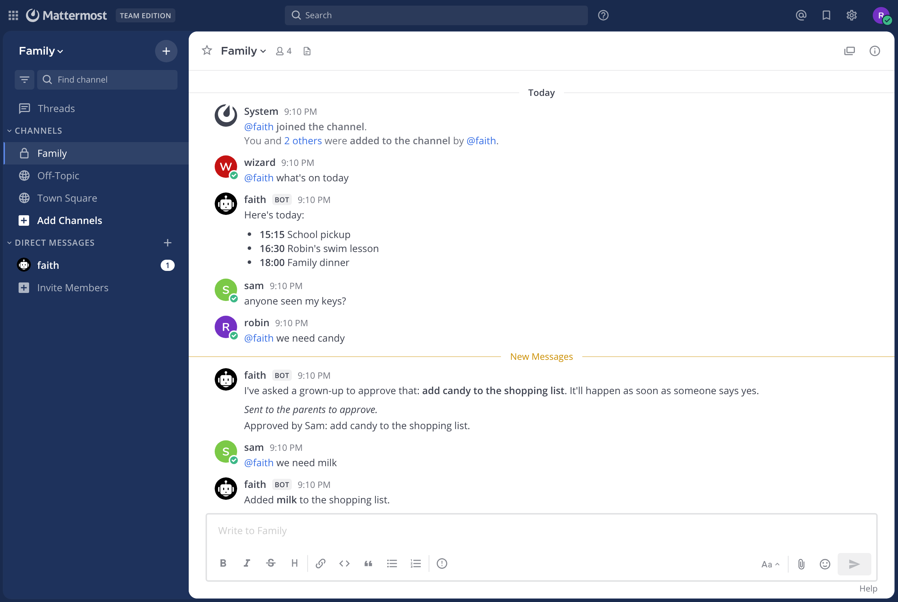
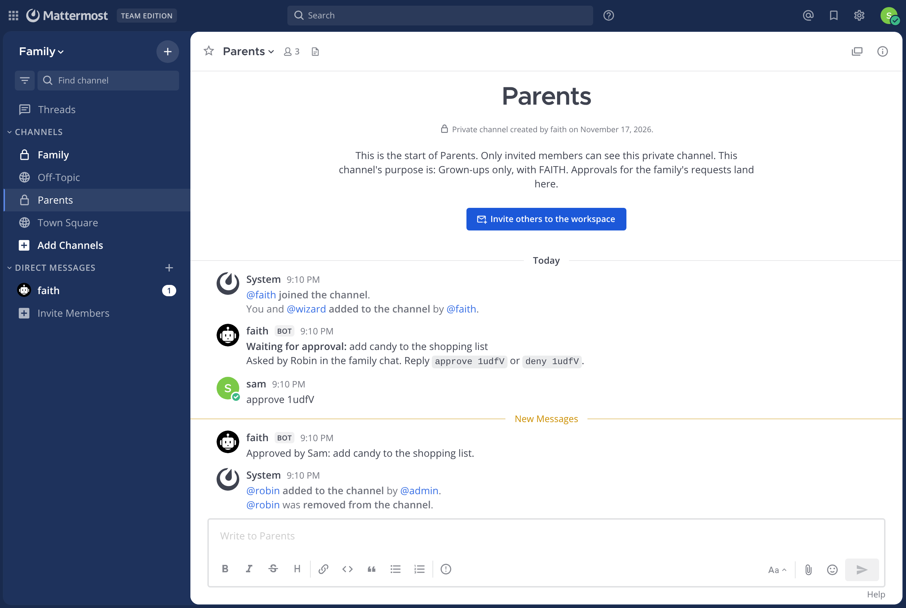
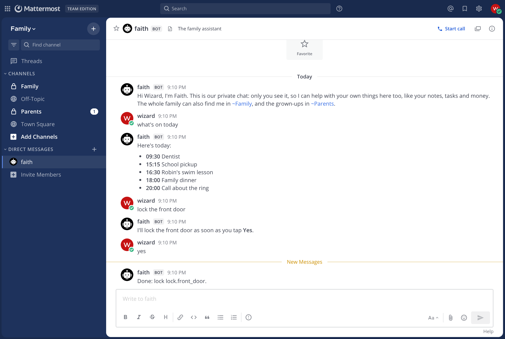

# FAITH in Mattermost

FAITH joins Mattermost as a bot and looks after three kinds of chat for the family.

| Chat | Who's in it | What FAITH can see there | Changes |
|---|---|---|---|
| **Personal**: a DM with each person | that person and FAITH | that person's own view, private notes, tasks and money included | happen; locks, alarm and garage wait for them to reply **yes** |
| **Family** (`~faith-family`) | everyone in `people:` with a Mattermost account | only the family's shared things (the household tokens), whoever asks | a grown-up's happen straight away; a child's are sent to the parents for approval |
| **Parents** (`~faith-parents`) | admins and adults | shared things, plus whatever a `parents_token_env` gives | happen; **approvals land here** |

FAITH makes the two channels (private) and opens a DM with each person.
- It keeps the members right: it adds the family, and removes anyone else. A child added to the parents' channel is taken out again within seconds.
- In the two group channels it answers only when called: `@faith ...`, or a message starting with its name ("Faith, what's for dinner?"). Set `answer_in_groups: always` to have it answer everything.

**Photos and voice messages.**
- **A photo** goes to the vision model (`model.vision_model`) with the question, or "What's in this photo?" if there isn't one.
  - In the group chats, FAITH only downloads a photo when it's asked (`@faith` or its name), not every picture people share.
- **A voice message** (any audio file) is turned into words by Argos and counts as what was said. FAITH shows what it heard (_Heard: "…"_) above its answer.
  - A voice message in a group chat that starts with "Faith, …" counts as calling it.
- Up to four attachments per message, and up to 15 MB each.

**A morning brief in each personal chat.** In the admin page, make a routine with *Runs as: each person, in their own chat* (for example the `morning-brief` skill, weekdays at 7:00).
- It runs once per person, with that person's own tokens.
- Each brief goes only to that person: their DM, and their phone if `ha_notify` is set. Their private things never reach anyone else.

| | | |
|---|---|---|
|  |  |  |

## Why the group chats only see shared things

Everyone in a group chat reads FAITH's answer. So even when Wizard asks in the family chat, FAITH answers from the household's view, not Wizard's: his private notes would otherwise be read by everyone. For private things, message FAITH directly. The speaker only changes *whose changes need approval*.

The parents' chat uses the household tokens too, unless a connector has a `parents_token_env`. Use that for things both parents may see but the children may not, e.g. a joint Coinpile token or a wiki token for a parents' folder.

## Approvals

When a child asks for a change in the family chat, or someone asks on a shared screen while nobody is signed in, FAITH posts it in the parents' chat:

> **Waiting for approval:** add candy to the shopping list
> Asked by Robin in the family chat. Reply `approve 1udfV` or `deny 1udfV`.

- Any grown-up replies there (or in their own DM with FAITH). The decision is posted back to the parents' chat, and to the chat the request came from.
- The admin can overrule a denial the same way (`approve <code>`).
- Approvals also show on FAITH's screens. Whichever comes first wins.

## Set up

1. **Make a bot account.** In Mattermost: System Console → Integrations → Bot Accounts → enable bot accounts, then *Add Bot Account* named `faith`.
   - Copy its token into `MATTERMOST_BOT_TOKEN` in FAITH's `.env`.
   - Add the bot to your team (Team → Add Members). Bots need team membership to make channels.
2. **Map accounts.** In `faith.yaml`, give each person their Mattermost username:
   ```yaml
   people:
     - { id: wizard, name: Wizard, role: admin, mattermost_username: wizard }
   mattermost:
     url: http://192.168.20.5:8065    # how FAITH reaches Mattermost
     team: family                     # the team's URL name
     # family_channel:  { name: faith-family,  display_name: Family }
     # parents_channel: { name: faith-parents, display_name: Parents }
     # answer_in_groups: mention      # or always
     # manage_members: true           # add the right people, remove everyone else
   ```
3. **Restart FAITH.** The log says `mattermost: chats ready` with the people it found, and warns about any username it couldn't find.

**What goes wrong:**
- **"FAITH's bot can't see the team":** the bot isn't in the team yet (step 1).
- **Nobody gets a DM:** the usernames in `faith.yaml` don't match Mattermost's (they're matched case-insensitively, and a leading `@` is fine).
- **No reply in a channel:** in group chats FAITH waits to be called; mention `@faith`.
- **Someone keeps being removed from a channel:** they aren't in `people:` (or they're a child in the parents' chat). Add them, or set `manage_members: false`.
- **Mattermost can't be reached:** FAITH logs it and tries again every minute; the websocket reconnects by itself.

## Testing it

`server/test/mattermost.test.ts` runs the bot against a fake Mattermost on every `npm test`.

Against a real one, with Docker:

```bash
docker run -d --name mattermost-test -p 8065:8065 mattermost/mattermost-preview
eval "$(server/scripts/mattermost/setup.sh)"
MATTERMOST_URL=http://localhost:8065 node --import tsx server/scripts/demo.ts &
node --import tsx server/scripts/mattermost/e2e.ts
```

`setup.sh` makes an admin, a `family` team, `wizard`, `sam` and `robin`, and the bot. `e2e.ts` logs in as each of them and checks all three chats (19 checks).
